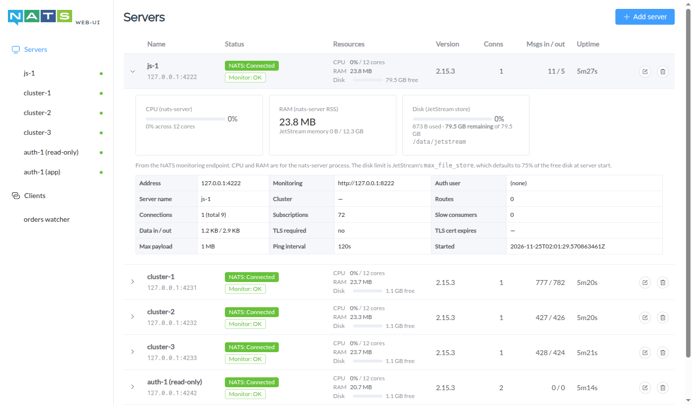
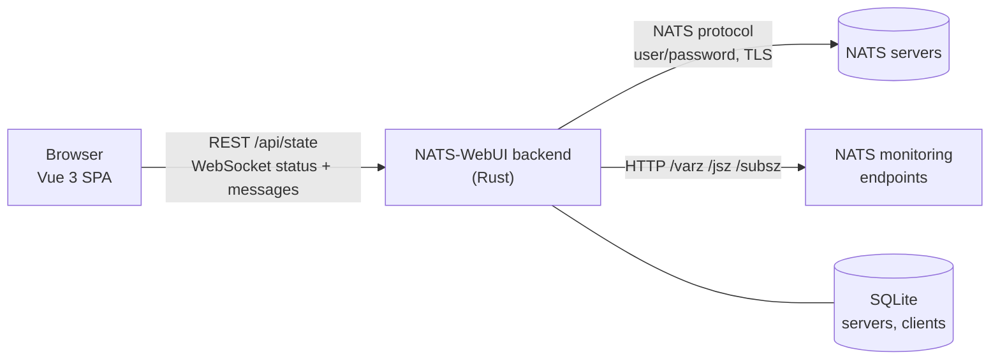

<p align="center">
  
</p>

# NATS-WebUI

[](https://github.com/titikterang/NATS-WebUI/actions/workflows/security.yml)

A web app for monitoring [NATS](https://nats.io/) servers and for watching and publishing messages.

> **About this fork.** This is an updated fork of [sphqxe/NATS-WebUI](https://github.com/sphqxe/NATS-WebUI), whose last release dates from 2020. It adds support for **current NATS versions (tested with nats-server 2.15) secured with username/password over TLS**. It also replaces outdated packages based on CVE scanning, restructures the code for easier maintenance, and ships ready-to-run local setups and examples.



## Features

- **Servers:** a node table with two health signals per server: the authenticated NATS connection (Connected, Connecting, Auth failed, Error) and the HTTP monitoring endpoint. Resources per node: nats-server CPU and memory, JetStream disk used and remaining.
- **Server dashboard:** live message and byte rates, configuration, **JetStream** streams and consumers, and subscriptions.
- **Clients:** watch subject patterns with `*` and `>` wildcards. Messages show in a table; expand a row for headers, the reply subject and pretty-printed JSON. Filter, pause and clear.
- **Publish** with headers. The server's permissions apply, and a refused publish is shown with the server's message.
- **Credentials stay on the server:** passwords are write-only, never returned by the API and never logged.
- **No built-in login:** run it behind nginx with TLS and basic auth, as described in [Securing access](documentation/securing-access.md).
- **Shareable URLs** for every screen, e.g. `/servers/3/jetstream`.

## What changed in this fork

| Area | Before (2020) | Now |
|---|---|---|
| NATS connection | No auth; TLS didn't work | Username/password, TLS with a private CA, per-server status |
| Backend | One 400-line `main.rs`, tokio 0.2, an unmaintained NATS client fork | Clean architecture on tokio 1, warp 0.3 and the official `async-nats` client |
| Frontend | Vue 2, Vue CLI 4 / webpack 4 (end of life) | Vue 3, TypeScript, Vite, Pinia, Element Plus |
| Runtime image | Debian, runs as root on port 80, 158 MB | Distroless without OpenSSL, non-root, port 8080, 50 MB |
| Tests | Database tests only | 29 Rust and 33 frontend unit tests, run by `make check` |
| Security checks | None | [Semgrep CE and Trivy](documentation/security-scanning.md) on every pull request to `master` |
| Docs and examples | One README | [Developer guides](documentation/README.md), plus local NATS setups and Node/Python/Go clients in [`example/`](example/README.md) |

### Security scan results

**The current code passes both public scanners**, [Semgrep Community Edition](https://semgrep.dev/docs/customize-semgrep-ce) 1.186.0 and [Trivy](https://trivy.dev/) 0.76.2, with no blocking findings:

| Scanner | Target | Result |
|---|---|---|
| Semgrep CE (`p/default`) | All source code | 0 findings |
| Trivy | Lockfiles: Cargo, npm, pip, Go | 0 vulnerabilities |
| Trivy | Secrets | 0 |
| Trivy | Dockerfiles | 0 misconfigurations |
| Trivy | Runtime image | 0 critical, 0 high (3 medium, 9 low, none fixable) |

The [Security scan](https://github.com/titikterang/NATS-WebUI/actions/workflows/security.yml) workflow repeats these checks on every pull request to `master` and fails on blocking findings. Run the same checks locally with `make scan`. Details are in [Security scanning](documentation/security-scanning.md).

What the CVE remediation in this fork fixed, compared with the 2020 code:

| Target | Before | After |
|---|---|---|
| Code (Semgrep) | 1 blocking finding (container runs as root) | 0 findings |
| npm dependencies | 275 CVEs (21 critical, 124 high) | 0 |
| Rust dependencies (`Cargo.lock`) | 0 | 0 |
| Runtime image | 266 CVEs (1 critical, 39 high), none fixable | 0 critical, 0 high |

## How it works

The browser talks only to the WebUI backend. The backend holds one NATS connection per configured server, polls each server's monitoring endpoint, and stores servers and credentials in SQLite.



Details, layers and runtime flows are in [Architecture](documentation/architecture.md).

## Quick start

With Docker, on http://127.0.0.1:8080:

```bash
docker build -t nats-webui .
docker run -d --name nats-webui -p 127.0.0.1:8080:8080 -v nats-webui-data:/data nats-webui
```

From source, with hot reload, on http://localhost:5173:

```bash
cp .env.example .env && make install && make dev
```

Then add a server: host, NATS port (4222), monitoring port (8222) and, if needed, a username and password. No NATS server at hand? `make -C example up-jetstream` starts one on `127.0.0.1:4222`; use it with the from-source setup, because inside a container `127.0.0.1` is the container itself.

## Documentation

| Guide | For |
|---|---|
| [Local development](documentation/local-development.md) | Running from source, the `make check` gate, where a change belongs |
| [Architecture](documentation/architecture.md) | Backend and frontend layers, routes, runtime flows, logging |
| [Deployment](documentation/deployment.md) | Docker image, private registry, hardened run, upgrades |
| [Securing access](documentation/securing-access.md) | **Recommended:** nginx with TLS and basic auth in front of the WebUI, which has no login of its own |
| [Connecting NATS](documentation/connecting-nats.md) | Single nodes and clusters, username/password, TLS with a private CA, troubleshooting |
| [Using the UI](documentation/using-the-ui.md) | Servers, JetStream, live messages, publishing |
| [Writing NATS clients](documentation/clients/README.md) | [Node.js](documentation/clients/node.md), [Python](documentation/clients/python.md) and [Go](documentation/clients/go.md) |
| [Configuration](documentation/configuration.md) | Every environment variable and make setting |
| [Security scanning](documentation/security-scanning.md) | Semgrep CE + Trivy: what blocks a pull request, `make scan`, repository settings |
| [Example setups](example/README.md) | Local NATS: single server, 3-node cluster, auth + TLS |

## License

MIT

## Authors

- Theodore Lee ([@sphqxe](https://github.com/sphqxe)), original author
- This fork: updated for current NATS versions, credentials and CVE remediation
