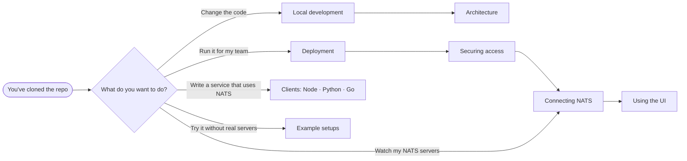

# NATS-WebUI documentation

Guides for developers and operators who've cloned this repository. Pick your goal below. Each page opens with what it covers, and pages link to each other instead of repeating information. The project overview is in the main [README](../README.md).

## Start here

| I want to… | Read |
|---|---|
| Run the WebUI from source and change it | [Local development](local-development.md), then [Architecture](architecture.md) |
| Run it on our server with Docker | [Deployment](deployment.md) |
| Put a password and HTTPS in front of it (recommended for every shared deployment) | [Securing access](securing-access.md) |
| Connect our NATS servers or cluster, with or without auth and TLS | [Connecting NATS](connecting-nats.md) |
| Learn the screens: servers, JetStream, live messages, publishing | [Using the UI](using-the-ui.md) |
| Write a Node.js, Python or Go service that talks to NATS | [Writing NATS clients](clients/README.md): [Node.js](clients/node.md) · [Python](clients/python.md) · [Go](clients/go.md) |
| Look up an environment variable or make setting | [Configuration](configuration.md) |
| Understand the Semgrep + Trivy checks on pull requests, or set up the repository rules | [Security scanning](security-scanning.md) |
| Try everything against local NATS servers | [Example setups](../example/README.md) |

## Prerequisites at a glance

| Goal | You need |
|---|---|
| Develop | Rust (stable), Node.js 24+, GNU Make; Docker for the examples |
| Deploy | Docker on the server, network access from it to every NATS server's client and monitoring ports |
| Connect a server | Host, client port, monitoring port (`http_port`), and if required a username/password and the CA certificate |
| Write clients | Node.js 24+, Python 3.13+ or Go 1.26+ |

## Words used in these docs

| Term | Meaning |
|---|---|
| **Server** | One entry in the WebUI: a NATS server, or one node of a cluster, with optional credentials. |
| **Client** | A saved set of subject patterns on one server, used to watch live messages and publish. |
| **Monitoring endpoint** | The NATS server's HTTP port (`http_port`, usually 8222) with `/varz`, `/jsz` and `/subsz`. |
| **Private CA** | A certificate authority you run yourself; its certificate goes into `NATS_CA_FILE`. |
| **Runtime image** / **debug image** | The production Docker image (distroless) and the local-only image with network tools. |
