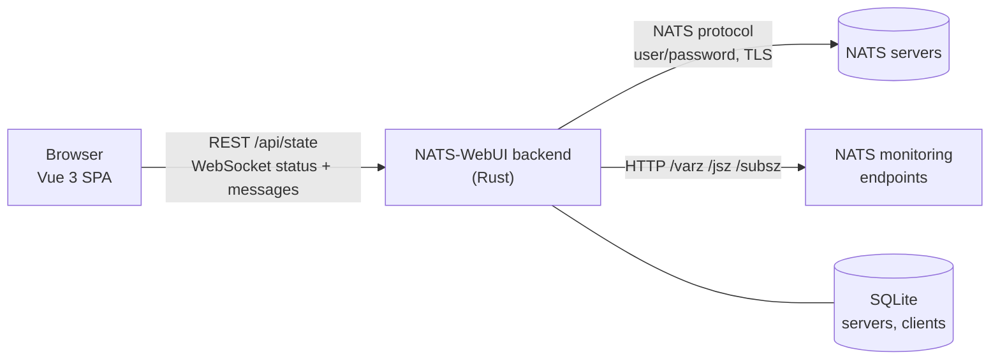
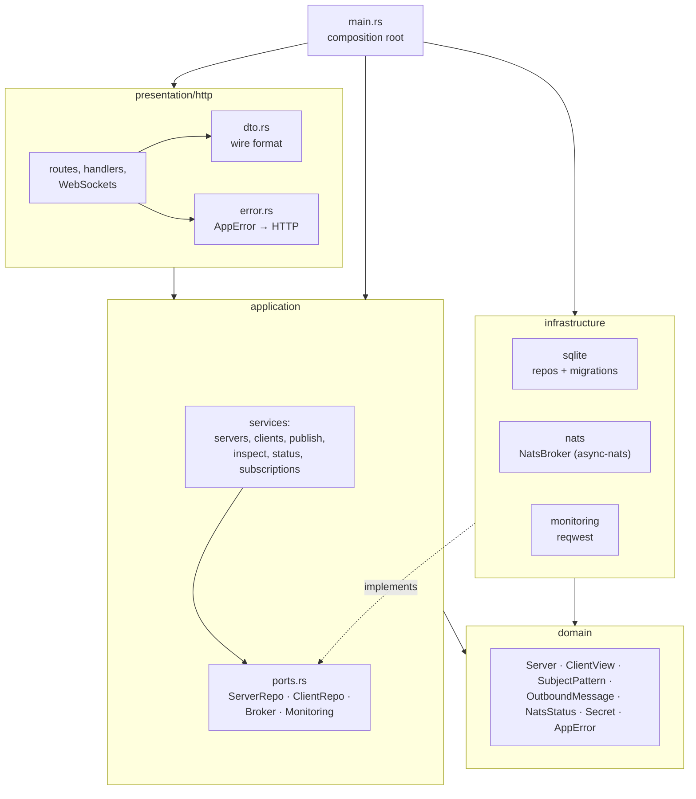
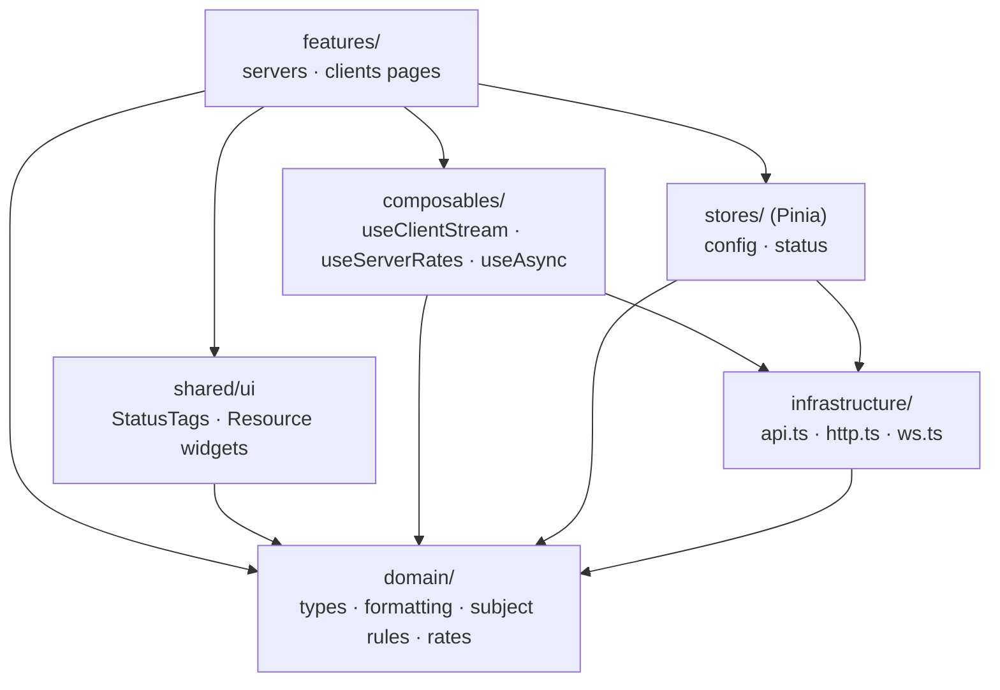
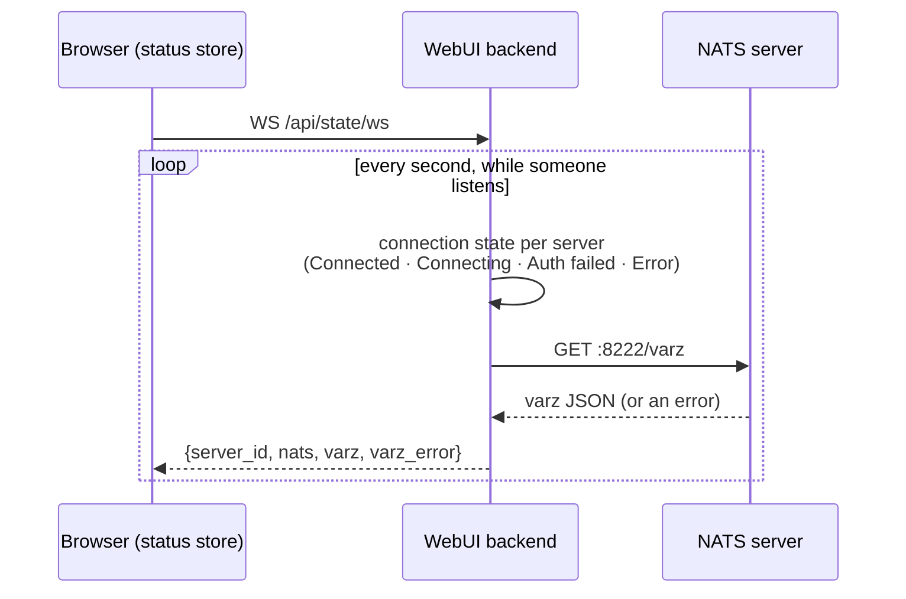
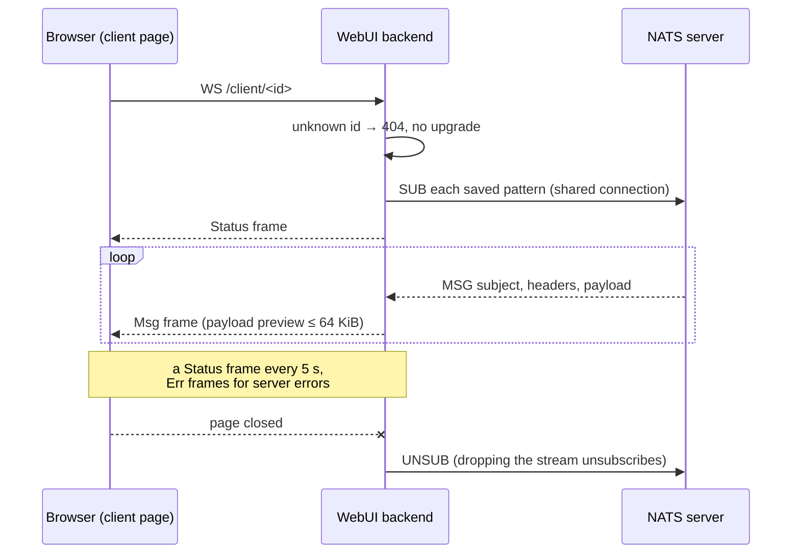
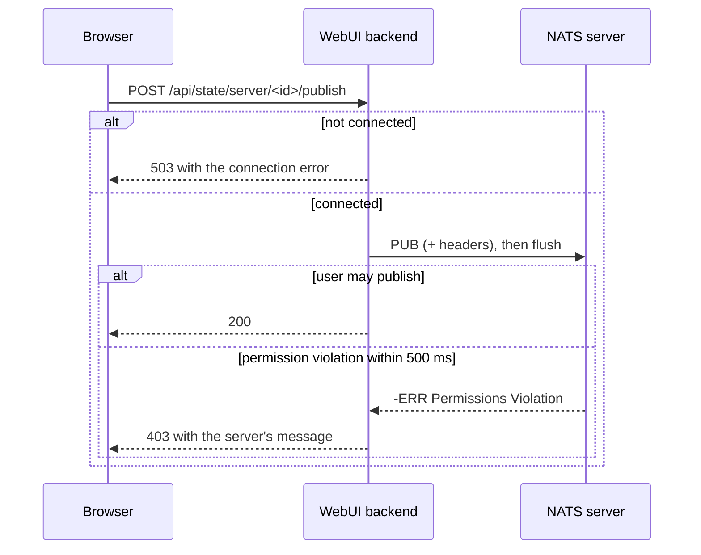

# Architecture

How the WebUI is built, and the rules that keep it maintainable. Read this before you change code. For setting up your machine, see [Local development](local-development.md).

- [System overview](#system-overview)
- [Backend layers](#backend-src-dependencies-point-inward)
- [Frontend layers](#frontend-websrc-the-same-rule-enforced-by-eslint)
- [HTTP and WebSocket routes](#http-and-websocket-routes)
- [Runtime flows](#runtime-flows)
- [Database and migrations](#database-and-migrations)
- [Logging](#logging)

## System overview

The browser never talks to NATS. The Rust backend holds one long-lived NATS connection per configured server, polls each server's HTTP monitoring endpoint, and relays everything to the browser over REST and WebSockets.

Two consequences matter for deployment:

- The NATS client port **and** the monitoring port must be reachable **from the WebUI host**, not from the browser.
- Credentials live only in the backend's SQLite database. The API never returns them.

## Backend (`src/`): dependencies point inward

| Layer | Contains | May depend on | Must not |
|---|---|---|---|
| `domain/` | Entities and rules: `ServerDraft` validation, `SubjectPattern` (NATS subject syntax), `NatsStatus::derive`, `Secret`, `AppError` | `std`, `thiserror`, `bytes` | Use warp, rusqlite, async-nats or serde on entities |
| `application/` | One service per use case, plus the port traits in `ports.rs` | `domain/` | Name a concrete adapter |
| `infrastructure/` | Adapters that implement the ports: `sqlite/`, `nats/`, `monitoring/` | `application/ports`, `domain/` | Contain business rules |
| `presentation/http/` | warp routes, handlers, WebSockets; `dto.rs` (the only wire format); `error.rs` (the only `AppError` → HTTP mapping) | `application/`, `domain/` | Talk to SQLite or NATS directly |
| `main.rs` | Reads config, builds the adapters, injects them into the services, starts the server | everything | — |

Why this shape: services are tested against the in-memory fakes in `application/fakes.rs`, without a database or a NATS server. Swapping an adapter (for example, another monitoring client) touches one folder.

Rules that come from real bugs:

- **`Secret` for every credential.** Its `Debug` and `Display` print `***`, and it doesn't implement `Serialize`, so a password can't reach a log or an API response by accident. Tests in `logging.rs` and `dto.rs` enforce this.
- **`varz` is relayed as raw JSON.** A strict typed struct broke on nats-server 2.15, because single nodes return `cluster: {}`. Don't reintroduce one.
- **`tls_optional()` with a CA.** In async-nats, adding a root certificate alone forces TLS on every server, which breaks plain `nats://` servers. `NatsBroker` adds `tls_optional()`, so TLS is used whenever the server requires it.

### Error mapping

Services return `AppError`. `presentation/http/error.rs` turns it into an HTTP status and a `{"error": "<message>"}` body:

| `AppError` | HTTP | Typical cause |
|---|---|---|
| `NotFound` | 404 | Unknown server or client id |
| `Validation` | 400 | Empty name, invalid subject pattern |
| `Unavailable` | 503 | Server not connected (yet) |
| `PermissionDenied` | 403 | NATS refused a publish for this user |
| `Upstream` | 502 | Monitoring endpoint failed, flush timed out |
| `Internal` | 500 | A bug; the only variant logged at `error` |

## Frontend (`web/src/`): the same rule, enforced by ESLint

| Folder | Contains |
|---|---|
| `domain/` | Plain TypeScript, no Vue. `types.ts` is the API contract and mirrors `src/presentation/http/dto.rs`. `subject.ts` holds the same rules as the Rust `SubjectPattern`. Formatting, status labels, rates. |
| `infrastructure/` | `http.ts` (axios, errors normalized to `ApiError`), `api.ts` (one typed function per endpoint), `ws.ts` (JSON WebSocket with backoff reconnect and an injectable factory for tests). |
| `stores/` | `config` (servers and clients; every change refetches) and `status` (the live status feed). |
| `composables/` | `useClientStream` (batched, capped, pausable message list), `useServerRates`, `useAsync`. |
| `features/` | Pages: `servers/` and `clients/`. |
| `shared/ui/` | Small reusable components. |

`eslint.config.js` enforces two boundaries with `no-restricted-imports`: only `infrastructure/` may import axios, and `domain/` may not import Vue, Pinia, Element Plus or `infrastructure/`. `make check` fails on a violation.

**When the API changes,** update `dto.rs` and `web/src/domain/types.ts` together.

## HTTP and WebSocket routes

The browser routes (`/servers`, `/servers/:id/:tab`, `/clients`, `/clients/:id`) are client-side; the backend serves `index.html` for any unknown path, so deep links work on reload.

| Method | Path | Purpose |
|---|---|---|
| GET | `/api/state` | All servers and clients. Passwords are never included; servers report `has_password`. |
| POST | `/api/state/server/new`, `/api/state/server/update` | Create or update a server. A blank password on update keeps the stored one. |
| GET | `/api/state/server/delete/<id>` | Delete a server and its clients. |
| GET | `/api/state/server/<id>/jsz`, `/api/state/server/<id>/subsz` | Pass-through of the server's JetStream and subscription monitoring data. |
| POST | `/api/state/server/<id>/publish` | Publish `{subject, payload, headers: [{name, value}]}` as the server's user. |
| POST | `/api/state/client/new`, `/api/state/client/update` | Create or update a client (a saved set of subject patterns on one server). |
| GET | `/api/state/client/delete/<id>` | Delete a client. |
| WS | `/api/state/ws` | Status feed: one JSON status per server per second. |
| WS | `/client/<id>` | Live messages for one client, as `Msg`, `Status` and `Err` frames. |
| GET | `/healthz` | Liveness, returns `ok`. Used by the container healthcheck; not logged. |

Requests under `/api/state` and `/client` always get a JSON answer: an unknown id returns 404, never the SPA page.

## Runtime flows

### Status feed

The poller runs only while at least one browser is connected. The connection state comes from the long-lived NATS client; resources and counters come from `/varz`.

### Client message stream

### Publish and permission violations

NATS doesn't reply to a publish. It reports a permission violation asynchronously as `-ERR 'Permissions Violation for Publish to "<subject>"'`. So the backend starts listening for server errors before it publishes, flushes, and waits up to 500 ms for a violation that names the subject.

## Database and migrations

SQLite (bundled with the binary) runs on tokio's blocking pool through `Db::call`. The schema is versioned with `PRAGMA user_version` in `src/infrastructure/sqlite/migrations.rs`:

- Never edit a released migration; append a new function to `MIGRATIONS`.
- Migrations only **add** tables and columns, so an older database always stays readable, and v0.1/v0.2 databases are adopted in place.
- Each migration runs in its own transaction.

`DATABASE_MAX_MB` is enforced with `PRAGMA max_page_count`. It bounds the only disk writes the app makes.

## Logging

The backend uses `tracing`. Libraries that log through the `log` facade are bridged into the same subscriber, so one filter (`RUST_LOG`) and one format (`LOG_FORMAT`) cover everything. The level conventions are documented at the top of `src/logging.rs`:

| Level | Use for |
|---|---|
| `error` | A bug or broken invariant (`AppError::Internal`) |
| `warn` | Trouble outside the process: auth or permission violations, unreachable servers |
| `info` | Lifecycle: startup, server created/updated/deleted, connections up or down, streams opened or closed |
| `debug` | Per-request detail, off by default |

- Put identifiers in fields (`server_id`, `client_id`, `subject`, `error`), not in the message text.
- Every HTTP request runs in an `http` span with `req`, `method` and `path`.
- Never log per NATS message.
- Log **or** return an error, not both.

The tests in `logging.rs` capture real log output and fail if a password appears or if a permission denial isn't a warning.
