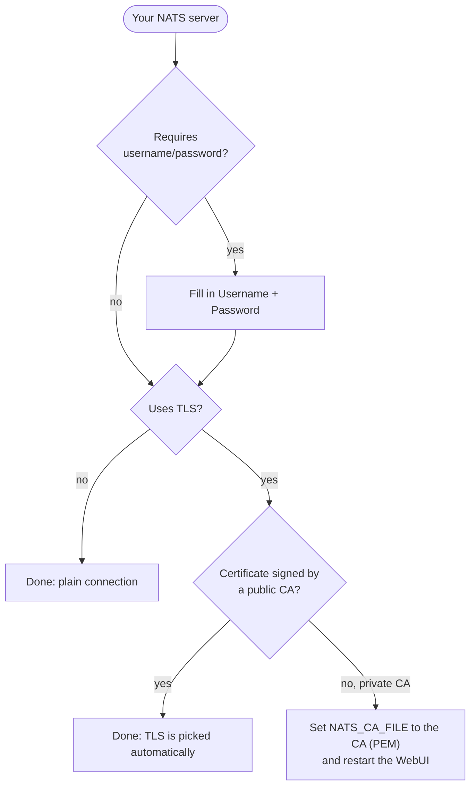

# Connecting your NATS servers

Connect the WebUI to NATS servers you already run: a single node or a cluster, without auth or with username/password, plain or TLS. To try it first against local servers, start the [example setups](../example/README.md).

## What the WebUI needs from each server

| Port | Default | Used for | Must be reachable from |
|---|---|---|---|
| Client port | 4222 | The NATS connection: status, subscriptions, publishing | the **WebUI host** |
| Monitoring port (`http_port`) | 8222 | `/varz` (resources, counters), `/jsz` (JetStream), `/subsz` (subscriptions) | the **WebUI host** |

The browser only talks to the WebUI, so neither port has to be open to users. Enable monitoring in `nats.conf` if it isn't:

```
http_port: 8222
```

The monitoring endpoint is plain HTTP with no auth. Restrict it with a firewall to the hosts that need it, including the WebUI host.

## Add a server

Open **Servers**, select **Add server**, and fill in:

| Field | Example | Notes |
|---|---|---|
| Name | `orders-prod-1` | Shown in the UI. |
| Host | `nats.example.internal` or `10.0.0.5` | Must match the server certificate (DNS or IP SAN) when TLS is used. |
| NATS port | `4222` | |
| Monitoring port | `8222` | |
| Username, Password | `monitor` / … | Leave both blank for a server without auth. On edit, a blank password keeps the stored one. |

The WebUI connects right away and keeps retrying in the background (every 1 to 15 seconds) if the server is down. Two status badges show the result; see [Status meanings](#status-meanings).

## Choose your setup



### Standard server, no auth

Fill in host and ports, leave the username and password blank. This is what `nats-server -js -m 8222` and the [`nats-jetstream` example](../example/README.md) give you.

### Username and password

Fill in the username and password of a NATS user. The password is stored in the WebUI's database, is never sent back to the browser, and never appears in logs.

The WebUI supports username/password only. Token, NKey, `.creds` (JWT) and client-certificate (mTLS) authentication aren't supported.

### TLS with a private CA

You don't choose TLS per server: the WebUI uses TLS whenever the server announces that it requires it, so plain and TLS servers work side by side. What you provide is trust:

- **Certificates from a public CA** work without any setting.
- **Certificates from your own CA:** give the WebUI the CA certificate in PEM format through `NATS_CA_FILE`, and restart it. In Docker, mount the file read-only (see [Deployment](deployment.md#3-run-it-on-the-server)); locally, use `make dev NATS_CA_FILE=/path/ca.pem`.
- **Several private CAs:** concatenate them into one file and point `NATS_CA_FILE` at it:

  ```bash
  cat prod-ca.pem staging-ca.pem > nats-ca-bundle.pem
  ```

The certificate is fully verified, including the host name. If you add servers by IP address, the server certificate needs that IP as a subject alternative name (`IP:10.0.0.5`).

Check that the WebUI host trusts a server with the `nats` CLI, which is in the [debug image](local-development.md#run-in-containers):

```bash
nats --tlsca /certs/nats-ca.crt -s tls://nats.example.internal:4222 \
  --user monitor --password "$MONITOR_PASSWORD" rtt
```

### A cluster

Add **each node as its own server**, for example `orders-prod-1`, `orders-prod-2` and `orders-prod-3`, with the same credentials. You then see every node's health and resources side by side, and you notice when one node is down.

For subscriptions and publishing, any one node is enough: messages are routed across the cluster. Create clients on the node you trust to stay up, or one client per node if you want to compare.

## Recommended users and permissions

Give the WebUI a **read-only user** for watching, and a separate server entry with a publishing user only where people need to publish. The [`nats-auth` example](../example/nats-auth/nats.conf) uses this model:

```
authorization {
  users: [
    # Watching in the WebUI: may subscribe to everything, may not publish.
    {
      user: monitor
      password: $MONITOR_PASSWORD
      permissions: {
        publish: { deny: [">"] }
        subscribe: { allow: [">"] }
      }
    }
    # An application, limited to its own subjects (plus replies and the JetStream API).
    {
      user: app
      password: $APP_PASSWORD
      permissions: {
        publish: { allow: ["app.>", "$JS.API.>"] }
        subscribe: { allow: ["app.>", "_INBOX.>"] }
      }
    }
  ]
}
```

`$MONITOR_PASSWORD` is read from the nats-server's environment, so the password isn't written in the file. You can also add a server twice, once as `monitor` and once as a publishing user, and give them clear names such as `orders-prod-1 (read-only)`.

NATS reports a refused publish asynchronously. The WebUI waits for it and shows the server's message, for example `Permissions Violation for Publish to "orders.created"`, as an error message, and as a banner on the client page while you are subscribed.

## Status meanings

Each server has two independent badges: the authenticated NATS connection and the monitoring endpoint. Hover over a red badge to see the error.

| Badge | Value | Meaning |
|---|---|---|
| NATS | Connected | Connected and authenticated. |
| NATS | Connecting | Connecting for the first time, or reconnecting, with no error yet. |
| NATS | Auth failed | The server rejected the username or password (`authorization violation`). |
| NATS | Error | Any other failure: unreachable, refused, TLS failure. The tooltip has the reason. |
| Monitor | OK | `/varz` answered. Resources and counters are live. |
| Monitor | Unreachable | `/varz` failed. NATS can still be Connected: the client port and the monitoring port are separate. |
| Monitor | Waiting | No status received yet. |

## Troubleshooting

| Symptom | Likely cause | Fix |
|---|---|---|
| **Auth failed** | Wrong username or password, or the user doesn't exist on this node | Check the user in `nats.conf` on **every** node; edit the server and re-enter the password. |
| **Error** with `nats: IO error` on a TLS server, while `nc -zv <host> 4222` succeeds | Almost always an untrusted certificate: the CA that signed it isn't in `NATS_CA_FILE`. (The client library doesn't pass on more detail. At startup the WebUI logs a warning when `NATS_CA_FILE` isn't set.) | Point `NATS_CA_FILE` at the right CA (or a bundle) and restart the WebUI. Confirm with the `nats … rtt` check [above](#tls-with-a-private-ca). |
| **Error**: `TLS error: the certificate of "…" is not valid for "<host>": it is issued for …` | The host you entered isn't in the certificate's subject alternative names | Enter one of the names the message lists, or reissue the certificate with your host name or IP. |
| **Error**, `connection refused` or a timeout | Wrong port, server down, or a firewall between the WebUI host and the server | From the WebUI host: `nc -zv <host> 4222`. |
| **Monitor Unreachable** while NATS is Connected | `http_port` isn't enabled, a different port, or a firewall | `curl http://<host>:8222/varz` from the WebUI host. |
| JetStream tab shows an error or "No JetStream streams on this server" | JetStream is off on that node, or the node holds no stream replicas | Check with `curl http://<host>:8222/jsz`. In a cluster, streams appear on the nodes that hold them. |
| Client shows no messages | No traffic on the patterns, or the user may not subscribe to them | Check the client's patterns and the user's `subscribe` permissions. Err frames in the client page name refused subscriptions. |
| Publish fails with a permissions violation | Working as intended for a read-only user | Publish from a server entry that uses a publishing user. |
