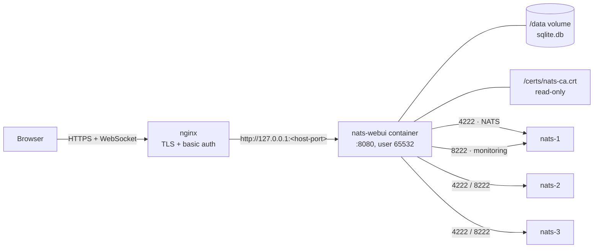

# Deployment

Run the WebUI on your own server with Docker: build the image, push it to your private registry, run it hardened, and put it behind a reverse proxy. For the variables mentioned here, see [Configuration](configuration.md).



The WebUI has **no login of its own**. Anyone who can open it can see message payloads and publish with the stored credentials. Run it behind nginx with TLS and basic auth, as described in [Securing access](securing-access.md).

## 1. Build the image

```bash
make docker-build TAG=v0.3.0           # = docker build --target runtime -t nats-webui:v0.3.0 .
```

The default `runtime` target is a distroless image of about 50 MB:

- no shell or package manager, and no OpenSSL (TLS is rustls);
- runs as user 65532, listens on port 8080;
- logs JSON;
- has a built-in `HEALTHCHECK` (`/app/nats-webui healthcheck`, every 30 s).

## 2. Push it to your registry

Set `REGISTRY` in `.env` (for example `registry.example.internal:5000`), then:

```bash
make docker-push TAG=v0.3.0
make docker-push TAG=v0.3.0 PUSH_LATEST=1      # also push :latest
```

`docker-push` refuses tags built from uncommitted work (`…-dirty`) unless you add `ALLOW_DIRTY=1`. It never pushes the `debug` image.

## 3. Run it on the server

### With `docker run`

```bash
docker run -d --name nats-webui --restart unless-stopped \
  -p 127.0.0.1:9080:8080 \
  -v nats-webui-data:/data \
  -v /etc/nats-webui/nats-ca.crt:/certs/nats-ca.crt:ro \
  -e NATS_CA_FILE=/certs/nats-ca.crt \
  --read-only --tmpfs /tmp:size=64m \
  --cap-drop ALL --security-opt no-new-privileges:true \
  --memory 256m --memory-swap 256m --cpus 1 --pids-limit 256 \
  --log-opt max-size=10m --log-opt max-file=3 \
  registry.example.internal:5000/nats-webui:v0.3.0
```

Pick any free host port instead of `9080`. Keep it bound to `127.0.0.1`, so only the proxy on the same host can reach it. Leave out the CA lines if none of your servers uses a private CA.

### With Docker Compose

Save as `compose.yaml` on the server and run `docker compose up -d`:

```yaml
services:
  webui:
    image: registry.example.internal:5000/nats-webui:v0.3.0
    restart: unless-stopped
    ports:
      - "127.0.0.1:9080:8080"
    environment:
      NATS_CA_FILE: /certs/nats-ca.crt
      DATABASE_MAX_MB: "256"
    volumes:
      - webui-data:/data
      - /etc/nats-webui/nats-ca.crt:/certs/nats-ca.crt:ro
    read_only: true
    tmpfs:
      - /tmp:size=64m
    cap_drop: [ALL]
    security_opt: ["no-new-privileges:true"]
    cpus: 1.0
    mem_limit: 256m
    memswap_limit: 256m
    pids_limit: 256
    logging:
      driver: json-file
      options: { max-size: 10m, max-file: "3" }

volumes:
  webui-data: {}
```

The image's built-in healthcheck applies to both. Check it with `docker ps` (the status column shows `healthy`) or `curl -s http://127.0.0.1:9080/healthz`.

### Why these flags

| Flag | Effect |
|---|---|
| `--read-only`, `--tmpfs /tmp:size=64m` | Nothing outside `/data` and a 64 MB `/tmp` can be written. |
| `DATABASE_MAX_MB` | Caps `/data/sqlite.db`, the app's only write. Beyond it, saving fails with "database is full" and the app keeps running. |
| `--log-opt max-size=10m --log-opt max-file=3` | Logs use at most 30 MB. Together with the two rows above, the container's disk use is bounded. |
| `--cap-drop ALL`, `no-new-privileges` | No Linux capabilities; nothing can gain privileges. The app needs none, because it doesn't use port 80. |
| `--memory`, `--memory-swap`, `--cpus`, `--pids-limit` | Resource limits. 256 MB is plenty for a few dozen servers. |

## 4. Put it behind nginx with TLS and basic auth

Don't expose the WebUI directly. Put nginx in front for HTTPS and a username/password prompt, and keep the WebUI's own port unpublished, or bound to `127.0.0.1`. [Securing access](securing-access.md) has the nginx config (including the WebSocket headers the UI needs), `htpasswd` user management, a compose file that runs both, and a checklist to verify it.

The UI picks `wss://` automatically when it's served over HTTPS. It must be served at the root path (`/`) of its host name; sub-paths such as `/nats-webui/` aren't supported.

## 5. Add your NATS servers

Open the UI and add each server, or each node of a cluster. [Connecting NATS](connecting-nats.md) explains the fields, the recommended read-only user and how TLS is chosen.

## Operate it

| Task | How |
|---|---|
| Logs | `docker logs nats-webui`. One JSON object per line with `timestamp`, `level`, `message`, `target` and fields such as `server_id`, `client_id` and `error`. Credentials never appear. Set `RUST_LOG=debug` for more detail. |
| Health | `docker inspect -f '{{.State.Health.Status}}' nats-webui` |
| Backup | Copy the database out: `docker cp nats-webui:/data/sqlite.db ./nats-webui-$(date +%F).db`. It contains the NATS passwords in plain text: store the backup like a secret. |
| Restore | Stop the container, copy the file into the volume as `sqlite.db`, start it. |
| Change the CA | Replace the file on the host and restart the container. |
| Upgrade | Pull the new tag and recreate the container with the same volume. Migrations run on startup and only add columns. |

## Upgrade from the upstream image

| What changed | Action |
|---|---|
| Container port 80 → **8080** | Change the mapping to `-p <host-port>:8080`. |
| Database path `/usr/local/bin/nats/sqlite.db` (the upstream image's working directory) → **`/data/sqlite.db`** | Find the old database before you remove the old container, for example `docker exec <old> ls -l /usr/local/bin/nats`. Copy it out with `docker cp <old>:/usr/local/bin/nats/sqlite.db .`, then into the new volume as `sqlite.db` (see the next row). If your old setup mounted a volume elsewhere, use that path. |
| Runs as root → **user 65532** | A database copied into the volume must be writable by 65532: `docker run --rm -v nats-webui-data:/data alpine chown -R 65532:65532 /data`. |
| Servers without credentials | Existing servers are kept. Edit each one to add a username and password if the server now requires auth. |

Old clients are migrated: their selected subjects become subject patterns.

## Production checklist

- [ ] The UI is reachable only through nginx with TLS and basic auth ([Securing access](securing-access.md)), and the WebUI's own port isn't published, or is bound to `127.0.0.1`.
- [ ] The host port maps to container port 8080, bound to `127.0.0.1` if the proxy is local.
- [ ] `/data` is a named volume or a host directory, and it's backed up as a secret.
- [ ] The CA file is mounted read-only and `NATS_CA_FILE` points at it (only if you use a private CA).
- [ ] Monitoring uses a [read-only NATS user](connecting-nats.md#recommended-users-and-permissions).
- [ ] Container hardening and limits are set as above.
- [ ] Logs reach your log pipeline, and the healthcheck is monitored.
