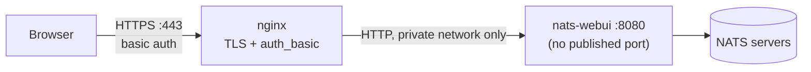

# Securing access: nginx with TLS and basic auth

The WebUI has **no login of its own**. Anyone who can open it can read message payloads, see your servers' configuration, and publish with the credentials stored in it. This guide puts nginx in front of the WebUI to add HTTPS and a username/password prompt (HTTP basic auth). It's the recommended setup for any shared deployment.



How it protects you:

- nginx answers every request without a valid username and password with `401`, including the API and both WebSockets. Nothing reaches the WebUI unauthenticated.
- The WebUI's own port is never published to the host, so it can't be reached around nginx.
- TLS protects the password: basic auth sends it with every request, so **never use basic auth over plain HTTP**.

The browser asks for the username and password once and then sends them with every request to that host name, WebSocket connections included. The UI needs no changes.

## 1. Create the password file

Create one `user:hash` line per person with `htpasswd` (bcrypt, `-B`). Use the `httpd` image if `htpasswd` isn't installed:

```bash
mkdir -p nginx
docker run --rm httpd:2.4-alpine htpasswd -nbB alice 'a-long-unique-password' >  nginx/htpasswd
docker run --rm httpd:2.4-alpine htpasswd -nbB bob   'another-long-password'  >> nginx/htpasswd
sudo chgrp 101 nginx/htpasswd && chmod 640 nginx/htpasswd   # 101 = the nginx user in the official image
```

nginx's worker processes must be able to read the file. If they can't, every request fails with `500`. `chmod 644` works too, but it lets every local user read the hashes.

The command line ends up in your shell history. To be prompted for the password instead, leave out `b` and the password: `docker run --rm -it httpd:2.4-alpine htpasswd -nB alice`.

| Task | Command |
|---|---|
| Add a user | Append a new line, as above |
| Change a password | Replace that user's line with a new one |
| Remove a user | Delete that user's line |
| Apply the change | `docker compose exec nginx nginx -s reload` |

Keep `htpasswd` out of git. It holds password hashes, not passwords, but a leaked hash can still be cracked offline.

## 2. Configure nginx

Save as `nginx/nats-webui.conf`:

```nginx
map $http_upgrade $connection_upgrade {
    default upgrade;
    ''      close;
}

server {
    listen 443 ssl;
    server_name nats-webui.example.internal;

    ssl_certificate     /etc/nginx/tls/fullchain.pem;
    ssl_certificate_key /etc/nginx/tls/privkey.pem;
    ssl_protocols       TLSv1.2 TLSv1.3;

    auth_basic           "NATS WebUI";
    auth_basic_user_file /etc/nginx/htpasswd;

    # Liveness for your uptime checks, without a password. It returns "ok" and nothing else.
    location = /healthz {
        auth_basic off;
        proxy_pass http://webui:8080;
    }

    location / {
        proxy_pass http://webui:8080;
        proxy_http_version 1.1;
        proxy_set_header Upgrade $http_upgrade;          # WebSockets: /api/state/ws and /client/<id>
        proxy_set_header Connection $connection_upgrade;
        proxy_set_header Host $host;
        proxy_read_timeout 1h;                           # keep idle WebSockets open
    }
}
```

Put your certificate (with its chain) and key in `nginx/tls/` as `fullchain.pem` and `privkey.pem`. The host name you open must match the certificate. There's deliberately no plain-HTTP listener: nothing, not even a redirect, is served without TLS.

## 3. Run nginx and the WebUI together

This compose file publishes only nginx. The WebUI is reachable from nginx over the compose network, and from nowhere else. It extends the hardened setup from [Deployment](deployment.md#with-docker-compose).

```yaml
services:
  webui:
    image: registry.example.internal:5000/nats-webui:v0.3.0
    restart: unless-stopped
    # No "ports:": only nginx can reach it.
    environment:
      NATS_CA_FILE: /certs/nats-ca.crt
    volumes:
      - webui-data:/data
      - /etc/nats-webui/nats-ca.crt:/certs/nats-ca.crt:ro
    read_only: true
    tmpfs: ["/tmp:size=64m"]
    cap_drop: [ALL]
    security_opt: ["no-new-privileges:true"]
    mem_limit: 256m
    cpus: 1.0
    pids_limit: 256

  nginx:
    image: nginx:1.30-alpine
    restart: unless-stopped
    depends_on: [webui]
    ports:
      - "443:443"          # or any free host port, e.g. "8443:443"
    volumes:
      - ./nginx/nats-webui.conf:/etc/nginx/conf.d/default.conf:ro
      - ./nginx/htpasswd:/etc/nginx/htpasswd:ro
      - ./nginx/tls:/etc/nginx/tls:ro
    mem_limit: 128m

volumes:
  webui-data: {}
```

```bash
docker compose up -d
docker compose exec nginx nginx -t            # validate the config after changes
```

If nginx already runs on the host, skip the `nginx` service. Publish the WebUI on loopback only (`ports: ["127.0.0.1:9080:8080"]`), use `proxy_pass http://127.0.0.1:9080;`, and add the `auth_basic` lines to your existing server block.

## 4. Check it

```bash
curl -s -o /dev/null -w '%{http_code}\n' https://nats-webui.example.internal/                # 401
curl -s -o /dev/null -w '%{http_code}\n' -u alice https://nats-webui.example.internal/       # 200 (asks for the password)
curl -s https://nats-webui.example.internal/healthz                                         # ok
```

Then open the UI in a browser, sign in, and open a client page: messages must stream in. If the page loads but the status badges stay grey, the WebUI's WebSockets aren't getting through. Check the `Upgrade` and `Connection` headers in the `location /` block.

## Limits of basic auth, and when to go further

Basic auth is one shared gate: everyone who signs in can do everything, and the WebUI doesn't know who they are. That fits a small team. Consider these additions:

| Need | Add |
|---|---|
| Slow down password guessing | `limit_req` on the server block, and fail2ban on nginx's error log |
| Restrict to the office or VPN as well | `allow 10.0.0.0/8; deny all;` next to `auth_basic` (both must pass, unless you set `satisfy any`) |
| Single sign-on, MFA, per-person audit | Replace basic auth with an identity-aware proxy, such as oauth2-proxy with nginx's `auth_request`, or your platform's SSO gateway |
| Limit what signed-in people can publish | Give the WebUI a [read-only NATS user](connecting-nats.md#recommended-users-and-permissions); the NATS server enforces it, whatever happens in the UI |

Whatever you put in front, the last row still applies: NATS permissions are the only control the WebUI can't bypass.
