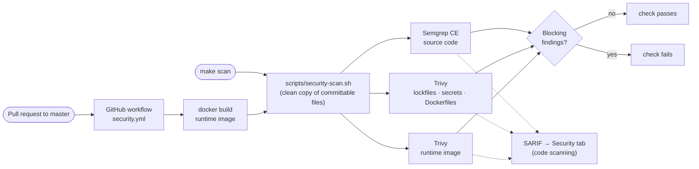

# Security scanning

Every pull request to `master` is scanned with [Semgrep Community Edition](https://semgrep.dev/docs/customize-semgrep-ce) and [Trivy](https://trivy.dev/), and fails on blocking findings. The same script runs on your machine with `make scan`, so a local run reproduces CI exactly. Both scanners run from public Docker images; no account, token or installation is needed.



## What's scanned, and what blocks

| Scanner | Target | Blocks the pull request when |
|---|---|---|
| Semgrep CE, ruleset `p/default` | All source: Rust, TypeScript/Vue, Dockerfiles, shell, YAML, the example clients | Any finding |
| Trivy, vulnerabilities | `Cargo.lock`, `web/package-lock.json`, and the example clients' `package-lock.json`, `requirements.txt` and `go.mod` | Any CRITICAL or HIGH vulnerability |
| Trivy, secrets | All committed files | Any secret found |
| Trivy, misconfigurations | Dockerfiles | Any CRITICAL or HIGH misconfiguration |
| Trivy, image | The runtime image built from the pull request | A CRITICAL or HIGH vulnerability **that has a fixed version** |

Unfixed image vulnerabilities are reported but don't block: there's nothing to upgrade to yet, and they come from the base image. Medium and low findings are reported only.

## How it's protected

- **Only committable files are scanned.** The script copies what git would commit into a temporary directory, always excluding `.env`, `sandbox/` and `credential/`, so local secrets never reach a scanner or a report.
- **Scanner images are pinned by version and digest** at the top of `scripts/security-scan.sh`. A moved or hijacked tag can't change what runs.
- **No third-party actions.** The workflow uses only GitHub's own actions (`checkout`, `upload-artifact`, `codeql-action/upload-sarif`), each pinned to a full commit SHA. This avoids the kind of action-tag hijacking that hit `aquasecurity/trivy-action` in March 2026.
- **Least privilege.** The workflow uses `pull_request`, never `pull_request_target`, and needs no secrets. Pull requests from forks run with a read-only token. They skip the SARIF upload; their results are still in the job summary and the artifact.
- **No Docker socket.** Images are handed to Trivy as a tarball.
- **No telemetry.** Semgrep runs with `--metrics=off`.

## Run it locally

```bash
make docker-build TAG=dev                           # optional: to scan the image too
make scan IMAGES="nats-webui:dev"                   # report only
make scan IMAGES="nats-webui:dev" SCAN_MODE=enforce # fail like CI
```

The first run downloads the scanner images and Trivy's vulnerability database (a few hundred MB, cached in `.security-reports/.trivy-cache`). The script prints a summary table:

```
| Scanner | Target | Result | Gate |
|---|---|---|---|
| Semgrep CE 1.186.0 | Source code | 0 findings | pass |
| Trivy 0.76.2 | Lockfiles (Cargo, npm, pip, Go) | 0 critical, 0 high, 0 medium, 0 low | pass |
| Trivy 0.76.2 | Secrets | 0 found | pass |
| Trivy 0.76.2 | Dockerfiles | 0 critical, 0 high, 0 medium, 3 low | pass |
| Trivy 0.76.2 | Image nats-webui_dev | 0 critical, 0 high, 3 medium, 9 low; 0 fixable critical/high | pass |
```

Each run writes the JSON and SARIF reports and `summary.md` to `.security-reports/<timestamp>/` (git-ignored). The variables are listed in [Configuration](configuration.md#make-variables).

## In GitHub

The workflow is `.github/workflows/security.yml`. It runs on:

- every pull request to `master`;
- every push to `master` (the baseline that code scanning compares pull requests against);
- manually, from **Actions → Security scan → Run workflow**.

A run takes about 10 to 15 minutes, most of it the Rust release build of the image. Its results show up in three places:

| Where | What |
|---|---|
| The pull request's checks | **Security scan** passes or fails |
| The run's **Summary** page | The summary table and every blocking finding |
| **Security → Code scanning** | Alerts from `Semgrep OSS` and `Trivy`, with file and line annotations on the pull request |

The run also keeps every report as the `security-reports` artifact for 14 days.

### Repository settings

Do these once, as a repository admin. Do them **after** the workflow has run on `master` at least once, because the check and the tools only appear in the settings lists after their first run.

1. **Settings → Actions → General**
   - *Actions permissions:* allow GitHub-owned actions (or all actions); the workflow uses only GitHub-owned ones.
   - *Workflow permissions:* keep **Read repository contents** (read-only). The workflow requests `security-events: write` itself.
   - *Fork pull request workflows:* require approval for first-time contributors.
2. **Settings → Rules → Rulesets → New branch ruleset**, targeting `master`:
   - **Require a pull request before merging.**
   - **Require status checks to pass** → add **Security scan**. This is the hard gate, and it also covers fork pull requests.
   - Optional: **Require code scanning results** → add the tools **`Semgrep OSS`** and **`Trivy`**, with *Security alerts: High or higher* and *Alerts: Errors*. Remove **CodeQL** from the list unless you enable it (next step); otherwise the rule waits for results that never come.
   - **Block force pushes.**
3. Optional: **Settings → Code security → CodeQL analysis → Set up → Default.** CodeQL is free for public repositories and adds a third analyzer (Rust, TypeScript, Actions). Only then keep CodeQL in the required tools.

## Fix or accept a finding

| Finding | What to do |
|---|---|
| Vulnerable dependency | Upgrade it: `cargo update -p <crate>`, `npm update <pkg>` in `web/`, or the example's lockfile. Re-run `make scan`. |
| Semgrep rule | Fix the code. For a false positive, add `// nosemgrep: <rule-id>` on that line, with a comment saying why. |
| Trivy misconfiguration | Fix the Dockerfile, e.g. add `USER 65532:65532` for non-root. |
| Unfixable image CVE | Nothing blocks. Check for a newer base image now and then (`docker build --pull`). |
| Real secret | Remove it, **rotate it** (it's in git history), then push. |

Accepting a vulnerability permanently is done with a `.trivyignore` file at the repository root, one ID per line with a comment explaining why. Keep that list short and reviewed.

## Upgrade the scanners

1. Pick new versions from the Trivy and Semgrep release notes.
2. Get the digests:

   ```bash
   docker pull aquasec/trivy:<version>
   docker image inspect -f '{{index .RepoDigests 0}}' aquasec/trivy:<version>
   ```

   Do the same for `semgrep/semgrep:<version>`.
3. Update `TRIVY_IMAGE` and `SEMGREP_IMAGE` at the top of `scripts/security-scan.sh`, run `make scan`, and open a pull request.

For the actions, update the SHA and the tag comment together. `git ls-remote --tags https://github.com/actions/checkout` lists the SHAs.
