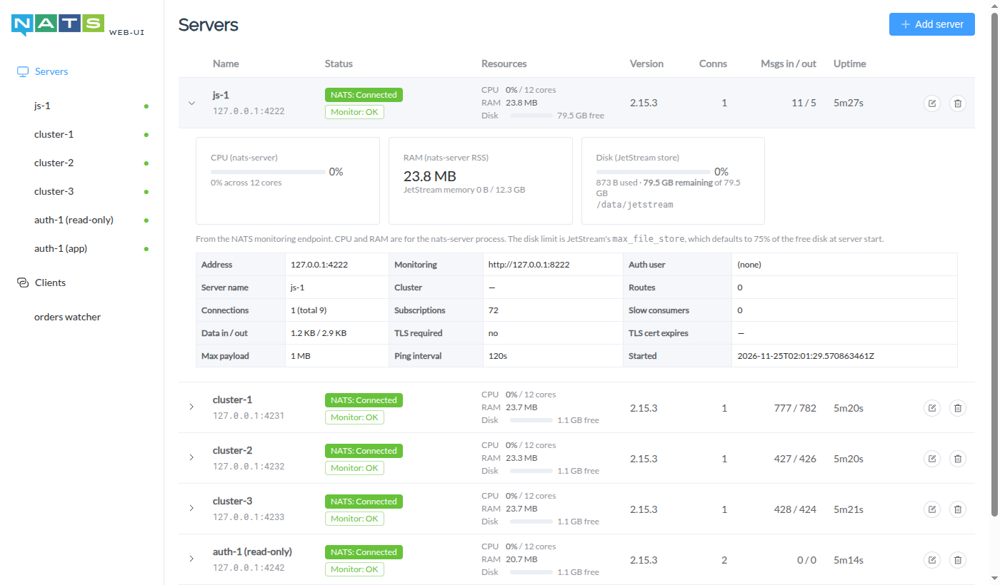
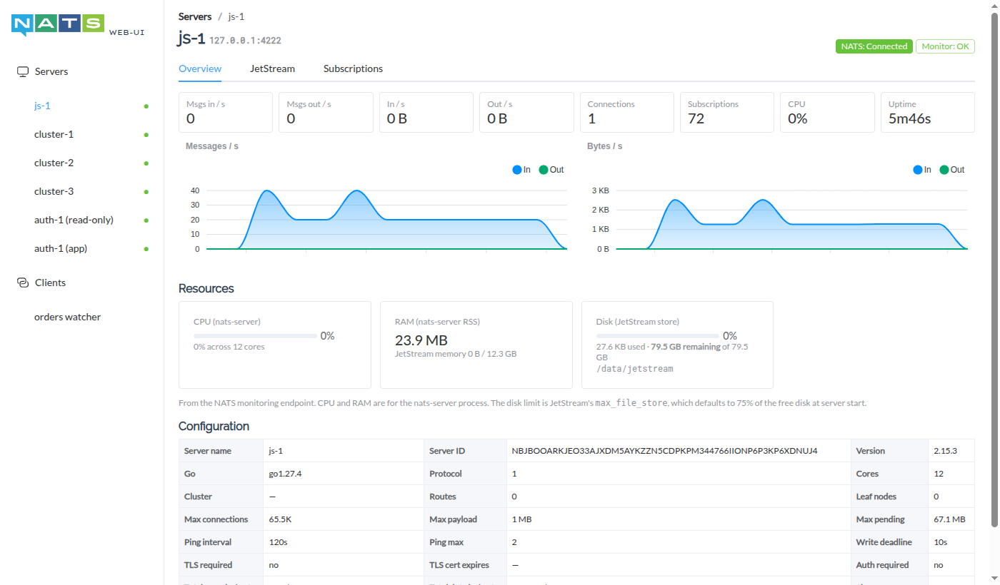
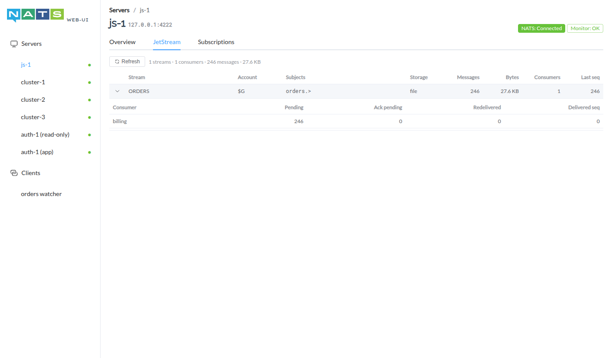
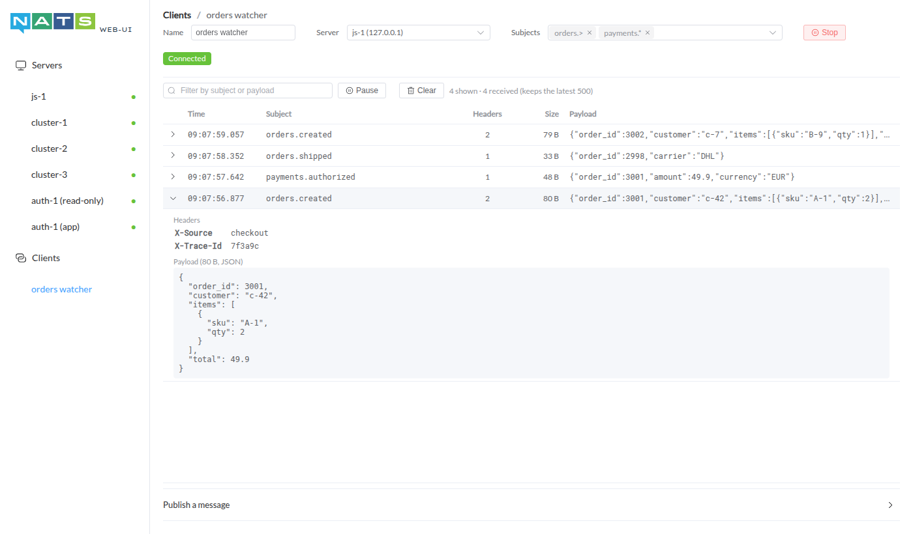
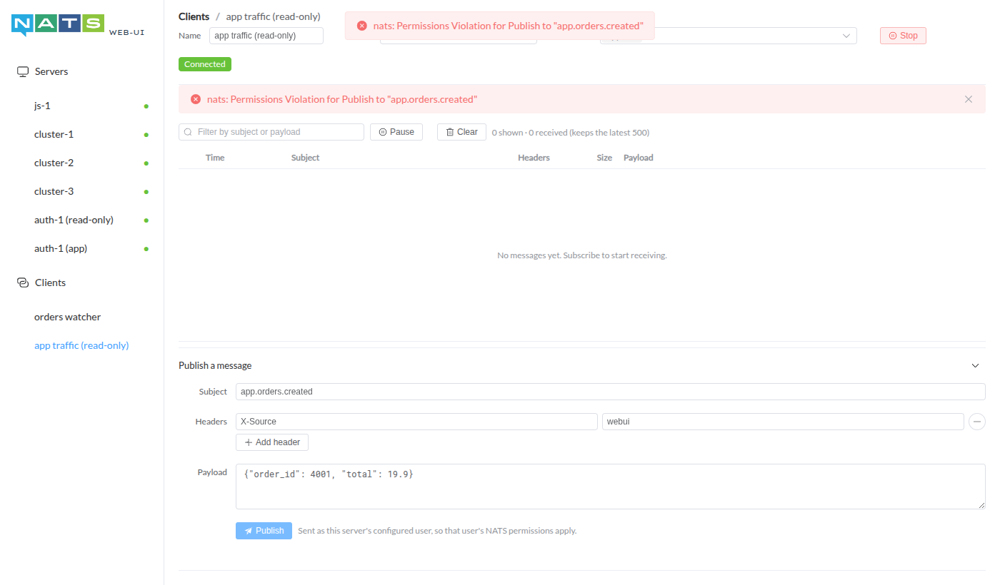

# Using the UI

A tour of the screens: check the health of your servers, inspect JetStream, watch live messages and publish test messages. The screenshots show the [example setups](../example/README.md). Every screen has its own URL, so you can bookmark it or paste it into a bug report.

| Screen | URL |
|---|---|
| Server list | `/servers` |
| Server dashboard | `/servers/<id>/overview`, `/servers/<id>/jetstream`, `/servers/<id>/subscriptions` |
| Client list | `/clients` |
| Client (live messages and publishing) | `/clients/<id>` |

## Servers: health at a glance

Each row is one NATS server, or one node of a cluster. To add one, select **Add server**; the fields are explained in [Connecting NATS](connecting-nats.md#add-a-server).

- **Status** has two badges: the authenticated NATS connection, and the HTTP monitoring endpoint. Hover over a red badge to see the reason. The values are explained in [Status meanings](connecting-nats.md#status-meanings).
- **Resources** shows the nats-server process's CPU and memory, and the JetStream store's free disk space.
- **Expand a row** for the resource cards and the connection details: auth user, cluster and routes, TLS, the certificate's expiry date, slow consumers.
- The dot next to each server in the sidebar repeats the NATS badge: green when connected, grey while connecting, red on an error.

Edit and delete are on the right of each row. When you edit a server, leave the password blank to keep the stored one. Deleting a server also deletes its clients.

## Server dashboard

Select a server in the sidebar to open its dashboard.

| Tab | Shows | Source |
|---|---|---|
| **Overview** | Live messages and bytes per second (in and out), connections, subscriptions, resources and the server configuration | `/varz`, every second |
| **JetStream** | Streams with subjects, storage, messages, bytes and last sequence. Expand a stream for its consumers: pending, ack pending, redelivered, delivered sequence. | `/jsz`; select **Refresh** to update |
| **Subscriptions** | The subjects that clients of this server subscribe to | `/subsz` |

In a cluster, the JetStream tab of a node lists the streams that have a replica on that node.

## Clients: watch live messages

A client is a saved set of subject patterns on one server. Open **Clients**, select **Add client**, then set:

- **Server:** the server entry to subscribe with. Its user's subscribe permissions apply.
- **Subjects:** one or more patterns. `*` matches exactly one token and `>` matches one or more tokens at the end: `orders.>` matches `orders.created` and `orders.eu.shipped`, and `payments.*` matches `payments.authorized` but not `payments.eu.authorized`. The UI checks the syntax before saving.

Select **Subscribe** to start. Changes to the name, server and subjects are saved automatically.

- The newest message is at the top. The table keeps the latest 500 messages.
- **Expand a message** for its headers, the reply subject (if any) and the payload. JSON payloads are pretty-printed; payloads over 64 KiB are cut in the preview, and the full size is still shown.
- **Filter** by subject or payload text. **Pause** freezes the table: messages are still counted but not added. **Clear** empties it.
- The badge next to **Stop** shows the subscription's connection state. If the connection drops, the page reconnects by itself.

## Publish a message

Expand **Publish a message** at the bottom of a client page. Enter a subject, optional headers and a payload, then select **Publish**. The message is sent through the client's server entry, so **that user's NATS permissions apply**.

When the user may not publish to the subject, NATS refuses it and the UI shows the server's message, here `Permissions Violation for Publish to "app.orders.created"`. With a [read-only monitoring user](connecting-nats.md#recommended-users-and-permissions) that's expected. To publish, use a server entry with a user that's allowed to.
